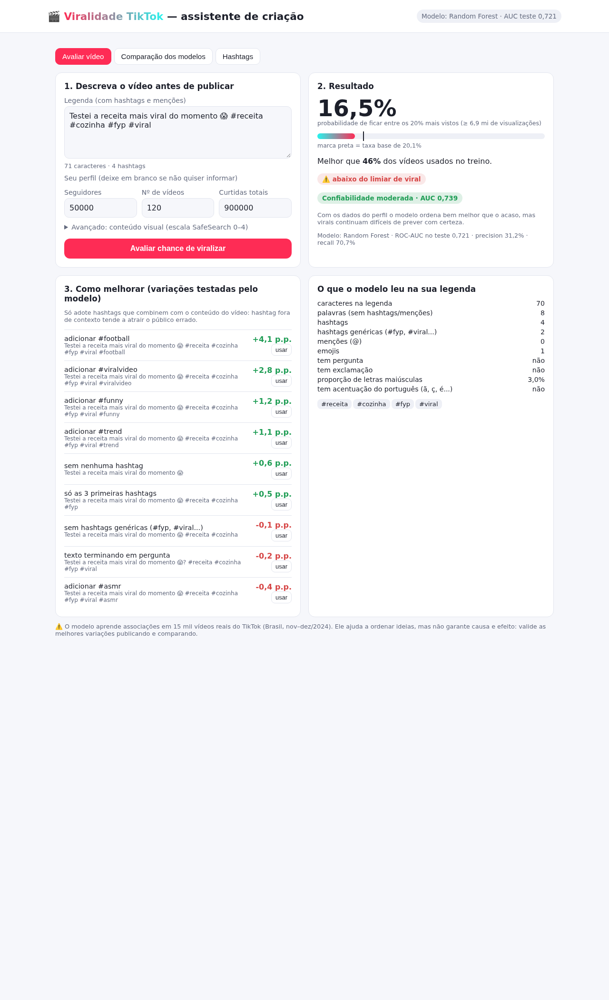

# 🎬 O que faz um vídeo curto viralizar? — Machine Learning Clássico no TikTok

Trabalho de Machine Learning que analisa **15.193 vídeos reais do TikTok** (feed "Para Você", Brasil, nov/2024–dez/2024) para (1) entender quais padrões estão associados à viralização e (2) construir um algoritmo que ajuda a avaliar e ajustar um vídeo **antes de publicar**.

Foram treinados e comparados **14 algoritmos** vistos na disciplina (de uma Regressão Logística até XGBoost, Voting e Stacking), com o mesmo pré-processamento, a mesma validação cruzada e o mesmo conjunto de teste reservado. O relatório completo, com a justificativa do modelo escolhido, está em **[`reports/RELATORIO.md`](reports/RELATORIO.md)**.

---

## 📦 Dados

| | |
|---|---|
| **Fonte** | Lacerda, T.; Locatelli, M. S.; Costa, I.; Carneiro, L.; Almeida, V.; Meira Jr., W. *Exploring Brazilian TikTok and YouTube Shorts: A Public Dataset for Video Characterization*. BraSNAM 2025, SBC. DOI [10.5753/brasnam.2025.9244](https://doi.org/10.5753/brasnam.2025.9244) |
| **Download** | Zenodo, DOI [10.5281/zenodo.15446544](https://doi.org/10.5281/zenodo.15446544) — licença CC-BY-4.0, uso acadêmico |
| **Plataformas** | TikTok (15.193 vídeos) e YouTube Shorts (10.925 vídeos) |
| **Plataforma analisada** | **TikTok** — é a mais completa (ver abaixo) |

**Por que só TikTok?** A proposta era separar a análise por plataforma usando só a que tivesse dados mais completos. No YouTube Shorts, `description` está vazia em 66% dos vídeos, `defaultLanguage` em 78%, `caption` é `false` em 99,5%, `dislike_count` é sempre 0 e **não existe o tamanho do canal**. O TikTok tem mais vídeos, métricas do criador (seguidores, curtidas e nº de vídeos) e legenda presente em 93% dos casos. Tabela completa: [`reports/tabelas/completude_plataformas.csv`](reports/tabelas/completude_plataformas.csv).

**Por que não o dataset do Kaggle `what-makes-a-yt-video-go-viral-12000-vids`?** Ele foi avaliado e descartado: é **sintético** (o próprio autor desaconselha usá-lo para análise real), contém **apenas YouTube** e os vídeos **não são curtos** (mediana de 614 s; só 23 dos 12.000 têm até 60 s).

## 🎯 Definição do problema

- **Alvo:** `viral = 1` se o vídeo está entre os **20% mais vistos** (≥ 6,9 milhões de visualizações). O limiar é calculado **só no treino** e aplicado ao teste.
- **Tipo:** classificação binária supervisionada (classe positiva = viral, 20%).
- **Entradas permitidas:** somente informações disponíveis **antes da publicação**:
  - **Criador:** seguidores, curtidas de outros vídeos, nº de vídeos, curtidas por vídeo. Quando os três campos vêm zerados juntos (20,8% dos vídeos), são tratados como **ausentes**.
  - **Legenda:** tamanho, palavras, hashtags, hashtags genéricas (#fyp, #viral...), menções, emojis, pergunta, exclamação, caixa alta, idioma/alfabeto e as 30 hashtags mais frequentes.
  - **Visual:** escores do Google SafeSearch (adult, medical, spoofed, violence, racy) nos 5 quadros-chave.
- **Entradas proibidas (vazamento):** curtidas, comentários, compartilhamentos e salvamentos do próprio vídeo. Elas só existem depois da publicação e crescem junto com as visualizações. O experimento de vazamento mostra o efeito de incluí-las.

## 🧪 Protocolo experimental

Segue o protocolo dos materiais da disciplina (Guia de Ensembles §9, gabarito da N1, Q4/Q5/Q14):

1. Divisão **80% treino / 20% teste** (`random_state=42`); o teste só é usado na avaliação final.
2. EDA, limiar do alvo, imputação, escala e vocabulário de hashtags são ajustados **só no treino**, dentro de um `Pipeline` + `ColumnTransformer`.
3. Tuning de hiperparâmetros com `GridSearchCV`/`RandomizedSearchCV` e `StratifiedKFold(5)` no treino.
4. **Métrica de seleção:** ROC-AUC médio na CV, que mede a capacidade de **ordenar** ideias de vídeo por chance de viralizar, independentemente do limiar. Como métricas de decisão, F1, Precision e Recall são reportados com o limiar escolhido por F1 nas previsões *out-of-fold* do treino.
5. **Regra de escolha (definida antes de ver os resultados):** maior AUC na CV; entre os modelos a até **1 erro-padrão** do melhor, escolhe-se o mais simples.
6. Confirmação no teste com **IC 95% por bootstrap pareado** (1.000 reamostragens) da diferença de AUC entre o escolhido e cada concorrente.

## 📁 Estrutura

```
src/
├── config.py                     # caminhos, constantes e grupos de colunas
├── baixar_dados.py               # baixa o dataset do Zenodo e valida o MD5
├── features.py                   # engenharia de features (criador, legenda, visual)
├── divisao.py                    # divisão treino/teste e limiar viral calculado no treino
├── eda.py                        # análise exploratória (somente treino) + completude das plataformas
├── modelos.py                    # pré-processamento + 14 modelos e espaços de busca
├── treinar_comparar.py           # tuning, CV, teste, bootstrap e escolha do modelo
├── experimentos_complementares.py# vazamento, ablação criador×conteúdo e validação temporal
├── interpretar.py                # permutation importance, importância por impureza, efeito médio, hashtags
├── clustering.py                 # K-Means de perfis de conteúdo (cotovelo, silhueta, ARI, PCA)
├── recomendar.py                 # núcleo do assistente + CLI: avalia uma legenda e sugere variações
└── app.py                        # interface local (FastAPI) que serve interface/index.html
interface/
└── index.html                    # página do assistente (HTML + JS puro, sem build)
docs/
├── README.md                     # índice dos materiais e onde cada um foi aplicado
└── materiais_disciplina/         # slides e guias do professor (escopo dos algoritmos)
reports/
├── RELATORIO.md                  # relatório final
├── figuras/                      # gráficos gerados
└── tabelas/                      # resultados em CSV
modelos/                          # modelos treinados (.joblib, não versionados)
```

## ▶️ Como rodar

```bash
python3 -m venv .venv
.venv/bin/pip install -r requirements.txt

.venv/bin/python -m src.baixar_dados
.venv/bin/python -m src.eda
.venv/bin/python -m src.treinar_comparar
.venv/bin/python -m src.experimentos_complementares
.venv/bin/python -m src.interpretar
.venv/bin/python -m src.clustering
.venv/bin/python -m src.app
```

A comparação completa leva cerca de 30–40 min em 16 núcleos.

### 🖥️ Interface local (recomendado)

```bash
.venv/bin/python -m src.app
```

Abra **http://127.0.0.1:8765** (ou escolha outra porta com `--porta 9000`). A página tem três abas:

- **Avaliar vídeo:** cole a legenda, informe seu perfil (seguidores, nº de vídeos e curtidas totais) e veja a probabilidade de o vídeo ficar entre os 20% mais vistos, o percentil, a **confiabilidade** da previsão e as variações da legenda que o modelo estima que aumentam ou diminuem a chance. O botão **usar** aplica a variação e reavalia.
- **Comparação dos modelos:** a tabela dos 14 algoritmos e os gráficos da comparação.
- **Hashtags:** o efeito médio estimado de adicionar cada uma das hashtags mais frequentes.

Também dá para abrir já avaliando, via URL: `http://127.0.0.1:8765/?legenda=minha%20legenda%20%23fyp&seguidores=50000&videos=120&curtidas=900000`



> Sem os três campos do perfil a confiabilidade é **baixa** (AUC ≈ 0,56): o conteúdo da legenda sozinho carrega pouco sinal. Com o perfil, AUC ≈ 0,74 em criadores nunca vistos no treino.

### Usando o algoritmo pela linha de comando

```bash
.venv/bin/python -m src.recomendar \
  --legenda "Testei a receita mais viral do momento 😱 #receita #cozinha #fyp #viral" \
  --seguidores 50000 --videos-autor 120 --curtidas-autor 900000
```

A saída traz a probabilidade de viralizar, o percentil em relação aos vídeos do treino e o efeito estimado de variações da legenda (remover hashtags genéricas, adicionar hashtags associadas a alcance, transformar o texto em pergunta etc.).

## 🛠️ Stack

Python 3 · pandas · NumPy · SciPy · scikit-learn · XGBoost · Matplotlib · Seaborn · joblib · FastAPI + Uvicorn (interface)
