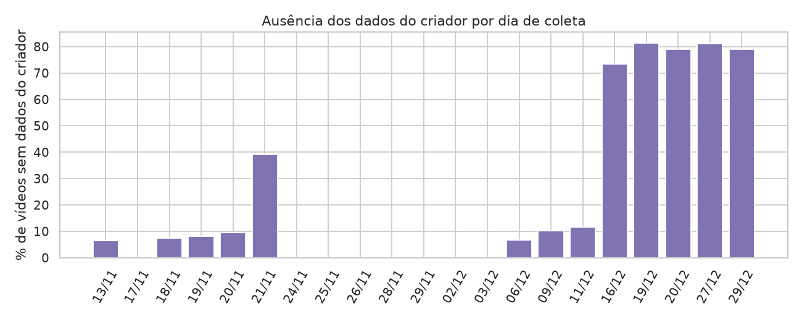
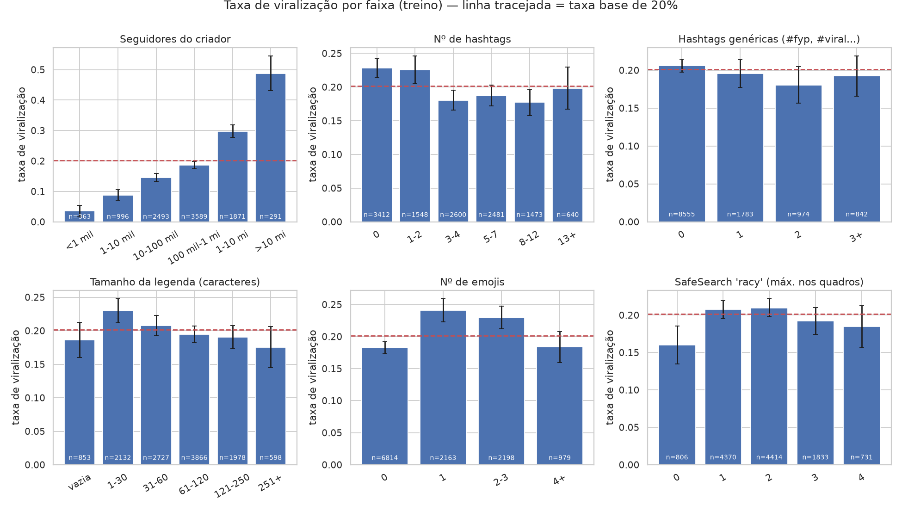
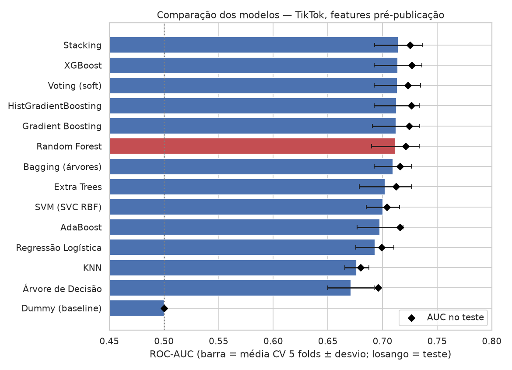
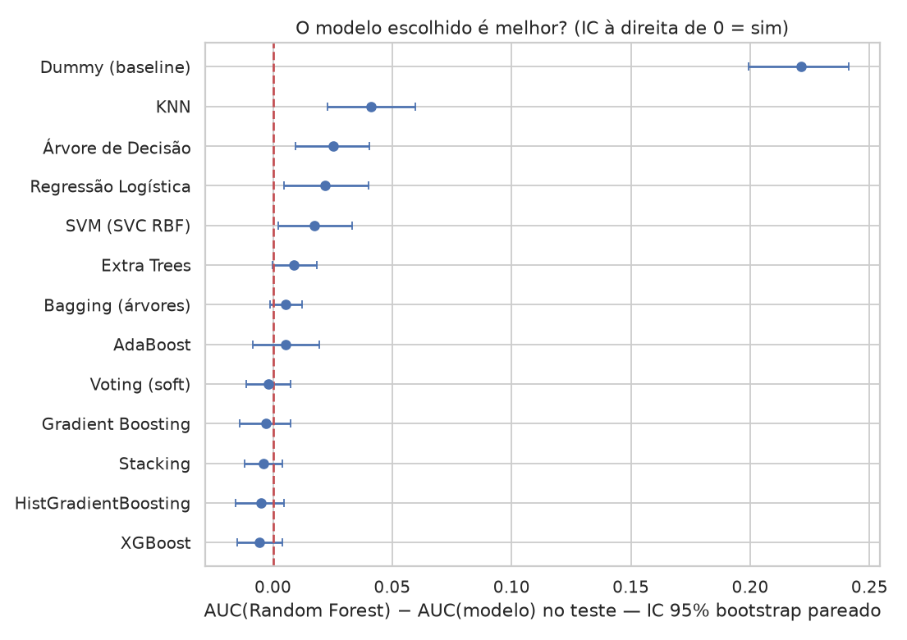
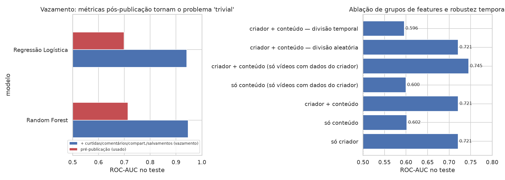
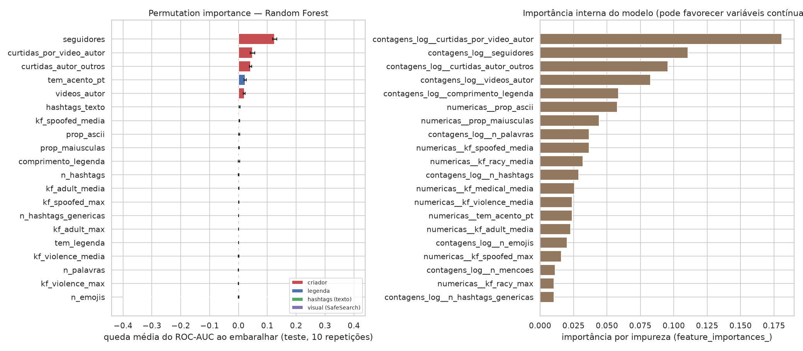
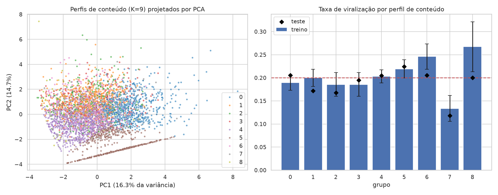

# Relatório — O que faz um vídeo curto viralizar no TikTok?

**Trabalho de Machine Learning Clássico** · dados reais de 15.193 vídeos do TikTok (Brasil, nov–dez/2024) · 14 algoritmos comparados

---

## 1. Resumo executivo

- **Pergunta:** usando apenas informações disponíveis **antes de publicar**, é possível estimar se um vídeo ficará entre os **20% mais vistos** (≥ 6,9 milhões de visualizações)? Quais padrões estão associados a isso?
- **Modelo escolhido: Random Forest.** ROC-AUC de **0,712 ± 0,022** na validação cruzada e **0,721** no teste (IC 95%: 0,699–0,741). Com o limiar ajustado para F1, encontra **70,7%** dos vídeos virais (*recall*), e **31,2%** dos vídeos que ele aponta como virais realmente viralizam (*precision*), contra 19,5% de acerto ao acaso.
- **Por que ele, e não o primeiro colocado?** Sete modelos ficaram **estatisticamente empatados**: Stacking, XGBoost, Voting, HistGradientBoosting, Gradient Boosting, Random Forest e Bagging. Pela regra de 1 erro-padrão, definida antes de ver os resultados, escolhe-se o mais simples desse grupo. No teste, nenhum dos mais complexos foi significativamente melhor que o Random Forest no bootstrap pareado.
- **O que mais pesa é o criador**, não a legenda:
  - Só com dados do criador o AUC chega a 0,696 na CV; só com conteúdo (legenda, hashtags e visual), 0,607; com tudo junto, 0,712.
  - O conteúdo tem sinal real, mas pequeno: cada ajuste de legenda muda a probabilidade em 1 a 4 pontos percentuais.
- **Limites importantes:**
  - Virais são, por natureza, difíceis de prever; a literatura descreve um teto de previsibilidade nesse tipo de problema.
  - Sem os dados do perfil, o modelo fica perto do acaso (AUC de 0,56).
  - Numa validação temporal, o AUC cai para 0,60. A queda é explicada principalmente por uma falha da coleta: os dados do criador somem nos últimos dias do dataset.
- **Entregáveis:** pipeline reprodutível (`src/`), comparação completa (`reports/tabelas/comparacao_modelos.csv`) e um **assistente local** (`python -m src.app`) que avalia uma legenda e sugere variações.

---

## 2. Premissas, mudanças de escopo e por quê

| Proposta inicial | O que foi feito | Motivo |
|---|---|---|
| Dataset do Kaggle `vedauv/what-makes-a-yt-video-go-viral-12000-vids` | **Descartado** | É **sintético** (o autor desaconselha análise real), contém **só YouTube** e os vídeos **não são curtos**: mediana de 614 s, apenas 23 de 12.000 com até 60 s |
| Vídeos curtos de Instagram, TikTok e Shorts, separados por plataforma, usando só a mais completa | Dataset real de TikTok e YouTube Shorts (UFMG/BraSNAM 2025); **análise no TikTok** | Instagram não tem dataset público equivalente com métricas e metadados (não encontrado). No YouTube Shorts, descrição vazia em 66%, idioma vazio em 78%, `caption` falso em 99,5%, `dislike` sempre 0 e **sem tamanho do canal**. O TikTok tem mais vídeos e dados do criador |
| Usar só o que foi visto na disciplina | Todos os algoritmos, pré-processamentos e métricas vêm dos materiais em `docs/materiais_disciplina/` | Ver `docs/README.md` |

---

## 3. Dados

**Fonte:** Lacerda, T.; Locatelli, M. S.; Costa, I.; Carneiro, L.; Almeida, V.; Meira Jr., W. (2025). *Exploring Brazilian TikTok and YouTube Shorts: A Public Dataset for Video Characterization*. BraSNAM 2025, SBC, p. 290–296. DOI [10.5753/brasnam.2025.9244](https://doi.org/10.5753/brasnam.2025.9244). Dados no Zenodo: [10.5281/zenodo.15446544](https://doi.org/10.5281/zenodo.15446544) (CC-BY-4.0, uso acadêmico).

**Como foi coletado (segundo os autores):**

- **TikTok:** pedidos à rota da *For You page* via biblioteca não oficial, a partir de Belo Horizonte, em cenário de "*cold start*" (sem histórico de usuário).
- **Visual:** 5 quadros-chave por vídeo, classificados pelo Google Vision SafeSearch.
- **Anonimização:** dados "desidratados"; não há ID do vídeo nem do autor.

**Consequências para a análise:**

- **Viés de seleção.** Todos os vídeos já foram recomendados pelo algoritmo do TikTok, então o problema é "*entre vídeos que chegam ao feed, quais estouram?*", e não "*entre todos os vídeos publicados*".
- **Visualizações acumuladas sem data de publicação.** Um vídeo antigo teve mais tempo para acumular visualizações. Não dá para corrigir isso; fica registrado como limitação.
- **Dados do criador ausentes.** Em 20,8% dos vídeos, `followers`, `hearts` e `videoCount` vêm **todos zerados ao mesmo tempo**, o que é ausência gravada como zero. Esses casos foram tratados como `NaN` + indicador (`SimpleImputer(add_indicator=True)`). A ausência se concentra nos últimos dias da coleta, de 73% a 81% a partir de 16/12 (figura 14).

---

## 4. Definição do problema

**Alvo.** `viral = 1` se as visualizações ficam **no top 20% do treino** (≥ 6.900.000). O limiar é calculado **só no treino** e aplicado ao teste, porque calcular o quantil com o teste seria vazamento estatístico (gabarito N1, Q5). As taxas resultantes são 20,1% no treino e 19,5% no teste.

**Por que classificação, e não regressão de visualizações?**

- A pergunta do criador é "*essa ideia tem chance de estourar?*".
- O AUC mede justamente a capacidade de **ordenar ideias** da mais para a menos promissora.

**Features (28 colunas brutas → 61 após o pré-processamento), todas disponíveis antes de publicar:**

| Grupo | Variáveis | Observação |
|---|---|---|
| Criador | seguidores, curtidas dos outros vídeos, nº de vídeos, curtidas por vídeo | `curtidas_autor_outros = heartCount − diggCount` retira as curtidas do próprio vídeo, que estão embutidas no total do perfil (vazamento sutil) |
| Legenda | tamanho, palavras, nº de hashtags, hashtags genéricas (#fyp, #viral...), menções, emojis, pergunta, exclamação, % maiúsculas, % ASCII, acentuação do português, alfabeto árabe | extraídas por expressões regulares |
| Hashtags | presença das 30 hashtags mais frequentes | `TfidfVectorizer(binary=True, use_idf=False, norm=None)`; o vocabulário é aprendido em cada fold de treino |
| Visual | média e máximo dos 5 quadros para adult, medical, spoofed, violence e racy (0–4) | Google SafeSearch |

**Excluídas por vazamento:** curtidas, comentários, compartilhamentos e salvamentos do próprio vídeo. Elas só existem **depois** da publicação e crescem junto com as visualizações. O experimento da §8.1 mede o efeito de incluí-las.

---

## 5. Análise exploratória (só treino)

**Tamanho do criador.** É o padrão mais forte e monotônico. A taxa de viralização vai de **3,6%** (menos de 1 mil seguidores) a 8,8%, 14,6%, 18,6% e 29,8%, até **48,8%** (mais de 10 milhões).

**Legenda.** Os efeitos são pequenos:

- Legendas curtas (1–30 caracteres) viralizam um pouco mais: 23,0%, contra 17,6% acima de 250 caracteres.
- Um a três emojis ficam em 23–24%; sem emoji, 18,2%.
- 0 a 2 hashtags ficam em 22–23%; 3 ou mais, em 18–20%.
- Hashtags genéricas (#fyp, #viral...) **não** aumentam a taxa: 20,6% sem nenhuma e 18,1–19,6% com elas.

**Correlação de Spearman com log(visualizações)** (figura 03):

- Seguidores e curtidas do criador: de 0,27 a 0,36. O nº de vídeos do criador quase não se correlaciona (0,007).
- Todo o resto: |ρ| ≤ 0,14.
- O maior valor negativo é a acentuação do português (−0,14), indício de que conteúdo local brasileiro alcança menos que conteúdo global no mesmo feed.

**Hashtags com n ≥ 40** (`tabelas/hashtags_taxa_viral.csv`):

- Taxas maiores: #cat 57,5%, #soccer 39,6%, #satisfying 39,5%, #football 37,6%, #dance 36,5%.
- Taxas menores: #bomdia, #freefire e #rust (0%), #status (1,5%).
- Os intervalos de confiança são largos (±9 a ±15 p.p.).

---

## 6. Protocolo experimental

O protocolo segue o Guia de Ensembles (§9.1, §9.6), os slides de avaliação e o gabarito da N1 (Q4, Q5 e Q14):

1. **Divisão 80/20** (`train_test_split`, `random_state=42`). O teste fica isolado até a avaliação final.
2. **Pré-processamento dentro do `Pipeline`:**
   - `ColumnTransformer` com `log1p` → `SimpleImputer(median, add_indicator)` → `StandardScaler` para as contagens.
   - `SimpleImputer` + `StandardScaler` para proporções e escores visuais.
   - `TfidfVectorizer` binário para as hashtags.
   - Tudo é reajustado **em cada fold**, o que evita vazamento no KNN e no SVM (Guia KNN §27).
3. **Tuning** com `GridSearchCV`, ou `RandomizedSearchCV` quando a grade é grande (15 a 30 combinações), usando `StratifiedKFold(5, shuffle=True, random_state=42)`, `scoring="roc_auc"` e **as mesmas dobras para todos os modelos**.
4. **Métrica principal: ROC-AUC.**
   - É independente de limiar e mede a capacidade de ordenar ideias por chance de viralizar.
   - É adequada para o desbalanceamento de 20/80, que tornaria a acurácia enganosa (gabarito Q6).
5. **Métricas de decisão.** F1, Precision e Recall da classe "viral", com o limiar escolhido por **F1 nas previsões *out-of-fold* do treino** (`cross_val_predict`). O teste nunca escolhe o limiar (gabarito Q14).
6. **Regra de escolha, definida antes de ver os resultados:**
   - Maior AUC médio na CV.
   - Entre os modelos a até **1 erro-padrão** desse melhor (EP = desvio/√5), escolhe-se o de **menor complexidade**.
   - Complexidade: Dummy < Logística < Árvore < KNN < SVM < AdaBoost < Bagging = RF = Extra Trees < GB = HistGB = XGBoost < Voting < Stacking.
   - Isso operacionaliza "*sempre compare com um modelo simples*" e "*maior sofisticação não garante ganho*" (slides de Ensembles).
7. **Confirmação no teste.** IC 95% por **bootstrap pareado**, com 1.000 reamostragens do teste, do AUC de cada modelo e da diferença `AUC(escolhido) − AUC(outro)`.
8. **Grades revisadas.** Na primeira rodada, KNN, AdaBoost, SVC e Árvore ficaram com hiperparâmetros na borda da grade. As grades foram ampliadas e tudo foi re-executado. A coluna `_na_borda` de `comparacao_modelos.csv` mostra o que ainda ficou na borda (§7.3).

---

## 7. Comparação dos 14 algoritmos

### 7.1 Resultados

| # | Modelo | AUC CV (média ± dp) | AUC teste [IC 95%] | F1 | Precision | Recall | Treino (s) |
|---|---|---|---|---|---|---|---|
| 1 | Stacking (RF + XGB + KNN + Log → Log) | 0,714 ± 0,022 | 0,725 [0,703–0,746] | 0,430 | 0,314 | 0,681 | 72,8 |
| 2 | XGBoost | 0,714 ± 0,022 | 0,727 [0,705–0,748] | 0,431 | 0,307 | 0,725 | 2,2 |
| 3 | Voting soft (RF + XGB + KNN + Log) | 0,714 ± 0,021 | 0,723 [0,701–0,744] | 0,429 | 0,313 | 0,683 | 15,4 |
| 4 | HistGradientBoosting | 0,713 ± 0,021 | 0,726 [0,704–0,747] | 0,435 | 0,327 | 0,646 | 8,6 |
| 5 | Gradient Boosting | 0,712 ± 0,022 | 0,724 [0,703–0,745] | 0,433 | 0,320 | 0,673 | 30,1 |
| **6** | **Random Forest ✅** | **0,712 ± 0,022** | **0,721 [0,699–0,741]** | **0,432** | **0,312** | **0,707** | **20,8** |
| 7 | Bagging (árvores) | 0,710 ± 0,017 | 0,716 [0,695–0,737] | 0,431 | 0,318 | 0,670 | 28,0 |
| 8 | Extra Trees | 0,702 ± 0,024 | 0,712 [0,690–0,734] | 0,418 | 0,295 | 0,713 | 31,9 |
| 9 | SVM (SVC RBF) | 0,700 ± 0,015 | 0,704 [0,681–0,725] | 0,426 | 0,314 | 0,664 | 49,9 |
| 10 | AdaBoost | 0,698 ± 0,021 | 0,716 [0,694–0,738] | 0,421 | 0,291 | 0,761 | 110,6 |
| 11 | Regressão Logística | 0,693 ± 0,017 | 0,699 [0,676–0,722] | 0,411 | 0,292 | 0,691 | 0,7 |
| 12 | KNN | 0,677 ± 0,011 | 0,680 [0,657–0,703] | 0,391 | 0,282 | 0,636 | 0,3 |
| 13 | Árvore de Decisão | 0,671 ± 0,021 | 0,696 [0,675–0,718] | 0,408 | 0,271 | 0,820 | 0,5 |
| 14 | Dummy (sempre a taxa base) | 0,500 | 0,500 | 0,327 | 0,195 | 1,000 | 0,1 |

Os hiperparâmetros escolhidos estão em `tabelas/comparacao_modelos.csv` (coluna `hiperparametros`). O tempo de treino é o tempo médio de ajuste de um fold.

### 7.2 Leitura estatística

- **Grupo de topo empatado.** Pela regra de 1 EP, o limite foi 0,7047. Ficaram acima dele, empatados: Bagging, RF, GB, HistGB, XGBoost, Voting e Stacking. As diferenças de AUC entre eles (≤ 0,005) são **4 vezes menores que o desvio-padrão entre folds** (≈ 0,02).
- **No teste, com bootstrap pareado (figura 07):**
  - Contra XGBoost, HistGB, Stacking, GB e Voting, o IC 95% da diferença **inclui zero** (por exemplo, XGBoost − RF = +0,006, IC de −0,004 a +0,015). **Não há evidência de que algum seja melhor que o RF.**
  - O RF é **significativamente melhor** que SVM (+0,018, IC 0,002–0,033), Regressão Logística (+0,022), Árvore (+0,025), KNN (+0,041) e Dummy (+0,221).
  - Contra Bagging, Extra Trees e AdaBoost, o RF fica à frente (+0,005 a +0,009), mas com IC tocando zero.
- **Modelos lineares e de distância ficaram atrás.**
  - Regressão Logística, KNN e SVM partem de fronteiras suaves ou de distâncias globais.
  - Os efeitos aqui são **não lineares e com interação**. Exemplos: o efeito do tamanho da legenda tem forma de "U" (figura 10), e o peso dos seguidores muda quando os dados do criador estão ausentes.
  - Isso é compatível com a literatura: árvores e ensembles de árvores costumam vencer em dados tabulares de porte médio (Grinsztajn et al., 2022).
- **Árvore isolada.** Teve a pior AUC na CV entre os não-baseline: é instável e de alta variância, exatamente o que Bagging e RF corrigem (slides de Ensembles, "Viés, variância e ruído").

### 7.3 Ressalva sobre hiperparâmetros na borda

Mesmo após a ampliação, alguns ficaram na borda:

- **XGBoost:** `learning_rate=0,01`, `subsample=0,7`, `colsample_bytree=1,0`, `min_child_weight=1`.
- **HistGB:** quatro parâmetros.
- **Gradient Boosting:** `min_samples_leaf=1`.
- **Bagging:** `max_samples=1,0`, que é um limite natural.
- **Árvore:** dois parâmetros.
- **Random Forest:** nenhum parâmetro na borda, ou seja, a busca dele **convergiu dentro da grade**.

Um tuning mais longo dos *boostings* poderia ganhar alguns milésimos de AUC. Pelo tamanho do erro-padrão, isso dificilmente mudaria o empate estatístico.

---

## 8. Por que continuamos com o Random Forest

1. **Desempenho estatisticamente equivalente ao melhor.** Está dentro de 1 EP do Stacking na CV, e nenhum concorrente foi significativamente melhor no teste.
2. **Regra de parcimônia definida antes do experimento.** Entre os empatados, Bagging e RF são os de menor complexidade; o RF teve AUC maior que o Bagging (0,712 contra 0,710) e diversifica as árvores também pelas colunas (`max_features=0,5`).
3. **Robustez com pouca configuração.** Os slides de Ensembles descrevem o RF como "*boa opção inicial quando queremos robustez com pouca configuração*". O tuning convergiu dentro da grade (`max_depth=12`, `min_samples_leaf=3`, `max_features=0,5`, 400 árvores). XGBoost e HistGB, ao contrário, exigiram vários parâmetros na borda, o que indica mais sensibilidade à configuração.
4. **Menos peças que Stacking e Voting.** Estes combinam quatro modelos (RF, XGBoost, KNN e Logística) e ganharam apenas +0,002 a +0,003 de AUC na CV. Isso é ruído diante do desvio de 0,022, e os slides lembram que "*Stacking mais complexo pode performar pior que RF*".
5. **Probabilidades razoáveis e recall alto.** Log loss de 0,440 no teste, contra 0,494 do baseline. Com o limiar de F1, o RF captura 70,7% dos virais, o segundo maior recall do grupo empatado, atrás só do XGBoost (72,5%). Para um criador, deixar escapar uma boa ideia (falso negativo) é o erro mais caro, e testar uma ideia mediana custa pouco.
6. **Interpretação.** Permite comparar `feature_importances_` com *permutation importance* (§9.1) e oferece o score OOB como validação interna adicional.

**Quando trocar.** Se o custo de treino ou inferência importar, por exemplo para reavaliar milhares de legendas, o **XGBoost** é o substituto natural: desempenho equivalente e treino cerca de 10 vezes mais rápido (2,2 s contra 20,8 s por fold).

---

## 9. Experimentos complementares (`src/experimentos_complementares.py`)

### 9.1 Vazamento: por que não usar curtidas, comentários e compartilhamentos

| Modelo | Só pré-publicação (usado) | + engajamento do próprio vídeo |
|---|---|---|
| Regressão Logística | CV 0,693 · teste 0,699 | CV **0,938** · teste **0,942** |
| Random Forest | CV 0,707 · teste 0,714 | CV **0,940** · teste **0,947** |

Com as métricas pós-publicação o problema parece "resolvido", mas isso é **vazamento**: no momento de decidir o que postar essas informações não existem. Muitos trabalhos e notebooks públicos de "previsão de viralização" relatam AUCs altos exatamente por esse motivo.

### 9.2 Ablação: criador × conteúdo

| Features | AUC CV | AUC teste |
|---|---|---|
| Só criador | 0,696 ± 0,014 | 0,721 |
| Só conteúdo (legenda + hashtags + visual) | 0,607 ± 0,014 | 0,602 |
| Criador + conteúdo | **0,712 ± 0,022** | **0,721** |
| Só conteúdo (vídeos com dados do criador) | 0,626 ± 0,017 | 0,600 |
| Criador + conteúdo (vídeos com dados do criador) | **0,739 ± 0,013** | **0,745** |

**Leitura.**

- O conteúdo sozinho carrega sinal (AUC de 0,60, acima de 0,50), mas fraco.
- Sobre o criador, o conteúdo acrescenta +0,016 de AUC na CV e praticamente nada no teste (0,7205 → 0,7211).
- **Neste dataset, quem publica explica bem mais do que o que se escreve na legenda.**

### 9.3 Identidade do criador (vazamento por grupo)

O dataset não traz ID de autor. A combinação (seguidores, curtidas totais, nº de vídeos) foi usada como "assinatura" do criador para verificar se o modelo memoriza criadores (Guia de Ensembles §9.4).

| Subconjunto do teste | n | Taxa viral | AUC |
|---|---|---|---|
| Todos | 3.039 | 19,5% | 0,721 |
| Criador também presente no treino | 259 | 13,5% | 0,825 |
| Criador nunca visto no treino | 2.780 | 20,1% | 0,712 |
| Criador nunca visto, **com** dados de perfil | 2.171 | 18,6% | **0,739** |
| Sem dados do criador | 609 | 25,3% | **0,563** |

**Leitura.**

- Só 8,5% do teste é de criadores já vistos. Nesses casos o AUC é bem maior, mas eles quase não alteram o resultado global (0,721 contra 0,712 sem eles).
- O desempenho realista para um **criador novo que informa seu perfil é AUC ≈ 0,74**.
- **Sem perfil, ≈ 0,56.** A interface mostra essa confiabilidade ao usuário.

### 9.4 Validação temporal

Treino nos dias até 10/12/2024 (11.314 vídeos) e teste de 11/12 a 29/12 (3.879 vídeos):

- **AUC total: 0,596.** A queda grande em relação ao 0,721 da divisão aleatória exigiu diagnóstico.
- **Causa principal:** 63% do teste temporal não tem dados do criador, contra 6% no treino, por causa do artefato de coleta da §3. Nesses vídeos o AUC é 0,543.
- **Com dados do criador: 0,685**, contra 0,739 na divisão aleatória.
- **A perda restante, de ≈ 0,05, é *drift*:** as tendências e hashtags do fim de dezembro diferem das de novembro.
- **Implicação:** o modelo precisa ser **retreinado periodicamente**. O que viraliza muda com as tendências, e um modelo de 2024 não deve ser usado sem atualização.

---

## 10. Interpretação: quais padrões o modelo aprendeu

### 10.1 Importância das variáveis

**Permutation importance** (queda do AUC no teste ao embaralhar a variável, 10 repetições):

- **Criador** (soma de 0,235): seguidores 0,125 · curtidas por vídeo 0,049 · curtidas dos outros vídeos 0,042 · nº de vídeos 0,020.
- **Legenda** (soma de 0,030): acentuação do português 0,023 · demais ≤ 0,003.
- **Hashtags** (0,004) e **visual** (0,002): praticamente irrelevantes isoladamente.

**Importância por impureza** (`feature_importances_`): também coloca o criador no topo, mas dá peso visivelmente maior a variáveis contínuas com muitos cortes possíveis, como tamanho da legenda, % ASCII, % maiúsculas e escores visuais. É o viés documentado por Strobl et al. (2007) e citado nos slides ("*pode favorecer variáveis com muitos pontos de corte*"). Por isso, **a interpretação se apoia na permutation importance**.

### 10.2 Efeito médio estimado (dependência parcial manual)

O cálculo fixa uma variável em vários valores para todos os vídeos de teste e mede a P(viral) média (figura 10). Os efeitos estão em pontos percentuais (p.p.) sobre a taxa base de ≈ 20%:

| Variável | Efeito |
|---|---|
| Seguidores | 100 → 13,7% · 10 mil → 17,5% · 100 mil → 23,9% · 1 mi → 29,7% · 30 mi → 38,2% |
| Menções (@) | 0 → 19,7% · 2 → 21,2% · 5 → 24,3% |
| Legenda com acentuação do português | sem → 21,8% · com → 17,1% |
| Tamanho da legenda | forma de "U": vazia 20,9%; 30–180 caracteres ≈ 19,9–20,2%; ≥ 250 caracteres 21,4–21,7% |
| Emojis | 0 → 19,7% · 1–4 → 20,2–20,3% · 10 → 21,5% |
| Hashtags genéricas | 0–2 → ≈ 19,8–19,9% · 5 → 20,9% |
| Nº de hashtags | ≈ 19,8–20,2% até 8; 20 → 21,1% |
| SafeSearch "racy" médio | 0–2 → ≈ 19,9%; 3 → 21,0%; 4 → 21,5% |

### 10.3 Efeito de adicionar uma hashtag

Média sobre os vídeos de teste que ainda não tinham a hashtag (figura 11):

- **Maiores aumentos:** #trend +2,8 p.p. · #viralvideo +2,5 · #asmr +2,1 · #football +2,0 · #funny +1,7 · #edit +1,6.
- **Reduções:** #novelinhas −0,4 · #fy −0,4 · #novelinhastiktok −0,2.

Essas hashtags marcam **nichos** (ASMR, futebol, humor, edits) que têm alcance global no feed. Adicionar a hashtag a um vídeo que não é do nicho não transforma o vídeo; ver §12.

### 10.4 Perfis de conteúdo (K-Means, `src/clustering.py`)

**Variáveis usadas.** Só as de conteúdo: legenda e visual, sem o criador.

**Escolha de K e estabilidade.**

- K de 2 a 10, avaliado por cotovelo e silhueta. A **silhueta máxima foi 0,142 (K=9)** e a curva ficou plana de K=6 a K=10.
- **Silhueta ≈ 0,14 indica estrutura fraca:** os estilos de legenda **não formam grupos naturalmente separados**.
- Estabilidade: ARI mediano de 0,98 entre sementes e de 0,97 entre subamostras, com mínimos de 0,54 e 0,62. Algumas inicializações produzem partições diferentes.

**Perfis encontrados.** São definidos principalmente por flags binárias: alfabeto árabe, pergunta, exclamação, CAIXA ALTA e menções.

**Taxa de viralização por perfil.**

- Fica perto de 20% em quase todos.
- **Exceção consistente:** o perfil de **legendas em CAIXA ALTA**, com 13,4% no treino e 11,8% no teste.
- O perfil "sem legenda" fica levemente acima: 21,9% no treino e 22,4% no teste.

---

## 11. Posição em relação à literatura

- **Limite de previsibilidade.** Martin, Hofman, Sharma, Anderson e Watts (WWW 2016) mostram que, mesmo com muitos dados, o tamanho de cascatas no Twitter tem uma parte **inerentemente imprevisível**: seus melhores modelos explicam menos da metade da variância. Salganik, Dodds e Watts (*Science*, 2006) mostraram experimentalmente que a influência social aumenta a desigualdade **e a imprevisibilidade** do sucesso. Um AUC de ≈ 0,72–0,74 com informação pré-publicação é coerente com esse teto, e não um sinal de modelagem fraca.
- **Criador × conteúdo.**
  - Khosla, Das Sarma e Hamid (WWW 2014), em 2,3 milhões de imagens do Flickr, encontraram que **pistas sociais** (tamanho da rede do autor) e **conteúdo** se complementam: combinar os dois supera cada um isoladamente. Nossa ablação mostra o mesmo padrão de complementaridade (criador 0,696, conteúdo 0,607, juntos 0,712), com o criador bem mais forte que o conteúdo.
  - Ling, Blackburn, De Cristofaro e Stringhini (arXiv 2021, TikTok) também apontam o **nº de fãs do criador** como o preditor mais forte e relatam AUC de 0,93. Esse número **não é comparável** ao nosso: eles usaram 400 vídeos rotulados manualmente, com atributos anotados (por exemplo, enquadramento, texto na tela, ponto de vista), e uma definição de viral e um desenho amostral diferentes. Aqui, a tarefa é separar o top 20% **dentro** de um feed que já é de vídeos recomendados.
- **Algoritmo.**
  - Liu et al. (arXiv 2025), em previsão de engajamento de vídeos curtos, selecionaram o XGBoost como o modelo mais estável entre os testados. Em nossos dados, o XGBoost ficou estatisticamente empatado com o RF, o que é consistente com esse resultado.
  - Grinsztajn, Oyallon e Varoquaux (NeurIPS 2022) mostram a vantagem de modelos de árvore em dados tabulares de porte médio, o que explica o grupo de topo.
- **Interpretação.** Strobl et al. (2007) justificam preferir a *permutation importance* à importância por impureza.

---

## 12. Limitações e ameaças à validade

1. **Associação não é causa.** O assistente mostra **o que o modelo associa** a viralizar, e não o que **causa** viralização (estudo de caso de clustering, slides 22–27). Adicionar `#asmr` a um vídeo que não é de ASMR não o torna viral; o efeito vem de vídeos de ASMR terem alcance maior. A validação de qualquer sugestão exige testes reais (A/B).
2. **Seleção pelo feed.** Todos os vídeos já foram recomendados, então o modelo não fala sobre vídeos que nunca chegam ao "Para Você".
3. **Visualizações sem data de publicação.** Parte da variação vem de idade do vídeo, o que não dá para controlar.
4. **Sem duração, áudio, música, horário de postagem nem conteúdo visual rico.** O SafeSearch mede apenas sensibilidade da imagem, não o tema. O artigo do dataset oferece os quadros-chave mediante solicitação; eles abririam espaço para variáveis visuais melhores, mas isso exigiria métodos fora do escopo da disciplina (redes convolucionais).
5. **Dados do criador ausentes em 20,8%**, concentrados no fim da coleta, e ***drift* temporal** (§9.4).
6. **Recorte geográfico e temporal.** Feed de Belo Horizonte, nov–dez/2024. Não vale para outras regiões ou épocas sem retreino.
7. **Uma plataforma.** O YouTube Shorts foi descartado por incompletude, e não há dados públicos equivalentes do Instagram. A comparação entre plataformas fica como trabalho futuro.
8. **Hiperparâmetros de alguns *boostings* na borda da grade** (§7.3).

---

## 13. O que um criador pode tirar deste trabalho

Todas as recomendações abaixo são associações observadas, de efeito pequeno; use-as como hipóteses para testar.

- **Construir audiência é o fator dominante.** Cada 10× em seguidores eleva a chance de viralizar em ≈ 4–6 p.p. A legenda ajusta a chance no máximo em 1 a 4 p.p.
- **Hashtags genéricas** (#fyp, #foryou, #viral) **não ajudam** na EDA. No modelo, o efeito é próximo de zero.
- **Hashtags de nicho com alcance global** (#asmr, #football, #funny, #edit, #trend) estão associadas a mais alcance, desde que **coerentes com o conteúdo**.
- **Evite legendas inteiras em CAIXA ALTA**, o único perfil consistentemente abaixo da média.
- **1 a 3 emojis e menções a outros perfis** estão associados a um leve aumento.
- **Conteúdo com acentuação do português** alcança menos no mesmo feed. Isso reflete o tamanho da audiência (local × global), não "escrever errado"; não é recomendação de mudar o idioma.
- **Use o assistente para comparar versões da mesma ideia** e para ordenar várias ideias por chance relativa. Não o use como garantia de resultado.

---

## 14. Próximos passos sugeridos

1. Solicitar os quadros-chave do dataset para extrair variáveis visuais mais ricas (cores, presença de rosto, texto na tela).
2. Coletar duração, horário de postagem e áudio, que não existem no dataset atual.
3. Prever a **taxa de visualizações por seguidor** (alcance relativo ao tamanho do criador). É um alvo que isola melhor o efeito do conteúdo.
4. Retreinar periodicamente e monitorar o *drift*.
5. Repetir a análise em YouTube Shorts e Instagram assim que houver dados completos.

---

## 15. Reprodutibilidade

- `random_state=42` em todas as divisões, modelos e buscas. Versões em `requirements.txt` (testado com Python 3.14, scikit-learn 1.9.1, XGBoost 3.4.1).
- Comandos: ver o [README](../README.md). A comparação completa leva ≈ 30 min em 16 núcleos.
- Todas as tabelas citadas estão em `reports/tabelas/` e todas as figuras em `reports/figuras/`.

---

## Referências

1. Lacerda, T.; Locatelli, M. S.; Costa, I.; Carneiro, L.; Almeida, V.; Meira Jr., W. (2025). Exploring Brazilian TikTok and YouTube Shorts: A Public Dataset for Video Characterization. *BraSNAM 2025*, SBC, 290–296. https://doi.org/10.5753/brasnam.2025.9244 · Dados: https://doi.org/10.5281/zenodo.15446544
2. Martin, T.; Hofman, J. M.; Sharma, A.; Anderson, A.; Watts, D. J. (2016). Exploring Limits to Prediction in Complex Social Systems. *WWW 2016*, 683–694. https://doi.org/10.1145/2872427.2883001 · arXiv:1602.01013
3. Salganik, M. J.; Dodds, P. S.; Watts, D. J. (2006). Experimental Study of Inequality and Unpredictability in an Artificial Cultural Market. *Science*, 311, 854–856. https://doi.org/10.1126/science.1121066
4. Khosla, A.; Das Sarma, A.; Hamid, R. (2014). What Makes an Image Popular? *WWW 2014*, 867–876. https://doi.org/10.1145/2566486.2567996
5. Ling, C.; Blackburn, J.; De Cristofaro, E.; Stringhini, G. (2021). Slapping Cats, Bopping Heads, and Oreo Shakes: Understanding Indicators of Virality in TikTok Short Videos. arXiv:2111.02452. https://arxiv.org/abs/2111.02452
6. Liu, H.; Wang, W.; Zheng, H.; Jiang, P.; Wang, Q.; Yan, R.; Sun, Q. (2025). Multi-Modal Video Feature Extraction for Popularity Prediction. arXiv:2501.01422. https://arxiv.org/abs/2501.01422
7. Grinsztajn, L.; Oyallon, E.; Varoquaux, G. (2022). Why do tree-based models still outperform deep learning on typical tabular data? *NeurIPS 2022 (Datasets and Benchmarks)*. arXiv:2207.08815. https://arxiv.org/abs/2207.08815
8. Strobl, C.; Boulesteix, A.-L.; Zeileis, A.; Hothorn, T. (2007). Bias in random forest variable importance measures: Illustrations, sources and a solution. *BMC Bioinformatics*, 8, 25. https://doi.org/10.1186/1471-2105-8-25
9. Materiais da disciplina (Prof. Dr. Rodrigo Ramos Silva, 2026): ver [`docs/materiais_disciplina/`](../docs/materiais_disciplina/) e o índice em [`docs/README.md`](../docs/README.md).
