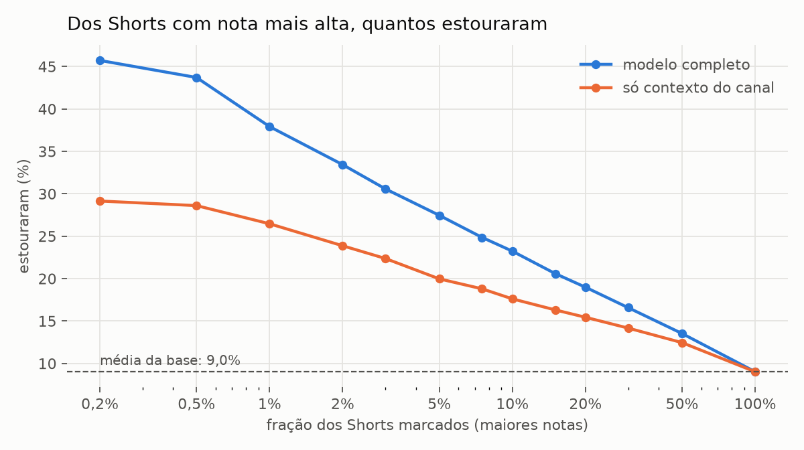
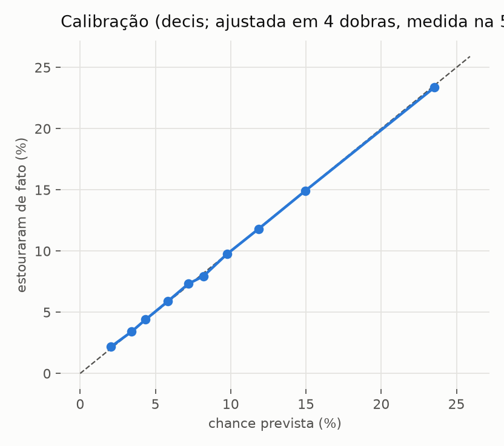
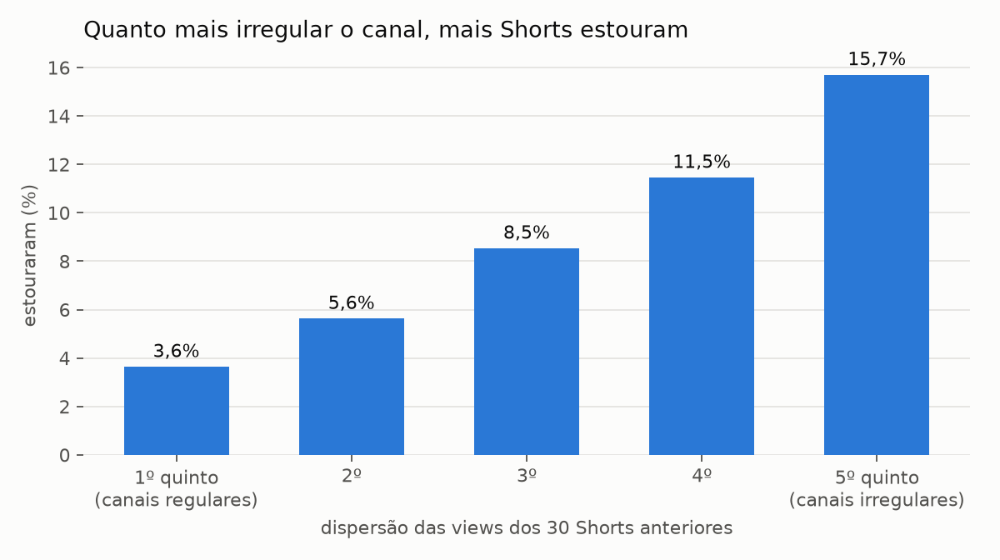

# Relatório v3 — "este Short vai estourar?" antes de postar

13/11/2026. Código em `src/v3/`, números em `reports/v3/validacao.json`, figuras em `reports/v3/figuras/` e tabelas em
`reports/v3/tabelas/`.

## Resposta curta

- O modelo separa bem melhor que o acaso, mas não é bola de cristal. **Quando ele diz VIRAL, acerta 39% das vezes**
  (fora da amostra, em canais que ele nunca viu). A média da base é 9%, então a chance fica 4,3 vezes maior. Em
  troca, ele só diz VIRAL para menos de 1% dos Shorts e deixa passar a maioria dos que estouram (recall de 3,6%).
- **Quando ele diz NÃO VIRAL** (36% dos Shorts), só 3,6% deles estouram. É o veredito mais útil no dia a dia: serve
  para descartar ideias fracas antes de produzir.
- A chance que ele dá é **calibrada**: dos Shorts com "23%", estouraram 23%.
- O que mais pesa é o **jeito do canal**. Canais regulares (todos os Shorts com views parecidas) quase não estouram
  (3,6%); canais irregulares estouram 15,7%. O conteúdo (título, capa, quadros do vídeo, parecença com o que já deu
  certo) soma bastante e é o que diferencia um Short do outro no mesmo canal.

## Dados

| | |
|---|---|
| Canais coletados | 523 (buscas em PT/EN/ES/DE/FR de explicação animada, "e se", ciência, curiosidade + os 54 canais da base v2) |
| Shorts | 123.178 (aba Shorts completa de cada canal + YouTube Data API) |
| No treino | 87.338 Shorts de 367 canais, 2022 em diante |
| Estouraram | 9,0% (≥ 5× a mediana dos 30 Shorts anteriores do canal **e** ≥ 5 mil views) |
| Conteúdo | título (vetor multilíngue), capa (CLIP), 3 quadros do vídeo a 25/50/75% (CLIP, cor, texto na tela, diversidade) |

Ficam fora do treino os Shorts com menos de 14 dias, os de canais com régua abaixo de 300 views e os primeiros
Shorts de cada canal (menos de 30 anteriores ou canal com menos de 90 dias; motivo na seção "Cuidados").

## Como foi validado

- **5 dobras por canal**: o modelo é sempre testado em canais que não viu no treino, como o Simulando.
- Tudo o que usa rótulo (vizinhos de "demanda", cabeças lineares) é refeito dentro de cada dobra, só com os canais
  do treino.
- O **limiar de cada veredito é escolhido nas outras 4 dobras** e medido na quinta: a precisão abaixo não foi
  ajustada nos mesmos vídeos em que foi medida.
- **Teste temporal**: treina com Shorts até maio/2026 e testa nos publicados de junho em diante, em 85 canais nunca
  vistos.

## Resultado

### Decisão VIRAL (limiar escolhido fora da dobra)

| precisão buscada | marcados como VIRAL | % dos Shorts | acertos | falsos positivos | precisão real | recall |
|---|---|---|---|---|---|---|
| 20% (PROMISSOR) | 14.809 | 17,0% | 2.961 | 11.848 | 20,0% | 37,6% |
| 25% | 6.477 | 7,4% | 1.615 | 4.862 | 24,9% | 20,5% |
| 30% | 2.913 | 3,3% | 869 | 2.044 | 29,8% | 11,0% |
| 35% | 1.355 | 1,6% | 465 | 890 | 34,3% | 5,9% |
| **40% (VIRAL)** | **731** | **0,8%** | **282** | **449** | **38,6%** | **3,6%** |
| 50% | 70 | 0,1% | 28 | 42 | 40,0% | 0,4% |

Acima de ~40% de precisão o modelo não sobe mais: a cada 5 Shorts marcados, 3 não estouram. Esse é o teto honesto de
um preditor pré-publicação com esses dados (a maior parte do resultado de um Short depende de como o primeiro
público reage, e isso não está no vídeo).

**NÃO VIRAL**: 36,4% dos Shorts; 3,6% deles estouram (40% da média). Deixa passar 14,5% dos que estouram.



### Métricas gerais

| | modelo completo | teste temporal (jun/2026+) |
|---|---|---|
| AUC | 0,698 | 0,696 |
| Average precision (base 9,0% / 9,8%) | 0,195 | 0,193 |
| AUC dentro do canal (Shorts do mesmo canal) | 0,643 | 0,616 |
| Precisão no top 0,5% / 1% / 5% | 43,7% / 37,9% / 27,5% | 30% / 35,4% / 27,6% |

O resultado se mantém no tempo: o modelo não está decorando uma época.



### Por fatia (modelo completo)

| fatia | Shorts | taxa base | AUC | dentro do canal | precisão top 1% |
|---|---|---|---|---|---|
| todos | 87.338 | 9,0% | 0,698 | 0,643 | 37,9% |
| canais animados | 30.357 | 8,4% | 0,697 | 0,644 | 35% |
| em português | 26.996 | 9,2% | 0,703 | 0,653 | 33% |
| canais pequenos (régua < 5 mil) | 30.985 | 6,9% | 0,719 | 0,643 | 37% |
| animados e pequenos (o caso do Simulando) | 7.477 | 5,3% | 0,698 | 0,624 | 23% |

Na fatia mais parecida com o Simulando, a precisão no topo cai para 23%, ainda 4,3 vezes a taxa base dela (5,3%).

### O que cada parte soma (ablação)

| features | AUC | AP | dentro do canal | top 1% |
|---|---|---|---|---|
| só contexto do canal | 0,648 | 0,150 | 0,583 | 26% |
| + meta e título | 0,674 | 0,172 | 0,612 | 32% |
| + capa | 0,679 | 0,175 | 0,619 | 32% |
| + quadros do vídeo | 0,682 | 0,177 | 0,625 | 33% |
| + novidade (parecença com o que o canal já postou e como foram os parecidos) | 0,699 | 0,195 | 0,642 | 39% |
| tudo (+ demanda em outros canais) | 0,698 | 0,195 | 0,643 | 38% |
| só conteúdo, sem o canal | 0,669 | 0,175 | 0,621 | 32% |

A "demanda" (títulos parecidos em outros canais) não acrescenta nada além do resto. Fica no modelo porque não
atrapalha e é útil na saída do `prever` (mostra como temas parecidos foram em outros canais).

### Por que o canal pesa tanto



A dispersão das views dos últimos 30 Shorts (o quanto o melhor se afasta da mediana) é a feature mais forte. Canal
que já teve picos tende a ter outros; canal em que tudo dá ~o mesmo número raramente dá um salto de 5×.

## Cuidados contra números bonitos e falsos

Cada correção derrubou a métrica e foi mantida, porque o número de antes não se repetiria na vida real:

1. **O futuro dos vizinhos.** As features de resultado do canal usavam Shorts com 2 dias, mas com as views finais.
   Na véspera, um Short de 2 dias ainda não mostrou o que vai fazer. O modelo aprendia "o canal está numa onda" com
   informação que ninguém tinha. Agora só entram Shorts com ≥ 7 dias. AUC: 0,737 → 0,710.
2. **Viés de sobrevivência.** A coleta achou canais que deram certo, então os primeiros Shorts deles estouram mais
   (13,5% nos canais com menos de 30 dias, 14,2% sem histórico maduro, contra 9%). No primeiro modelo, os 5 Shorts
   recentes do Simulando saíram todos PROMISSOR (22% a 31%) e nenhum estourou. Os Shorts iniciais saíram do treino.
   A idade do canal e o número de Shorts anteriores saíram das features (o Simulando tem 9 dias e 15 Shorts, fora do
   que o treino conhece).
3. **Calibração medida fora da amostra.** A isotônica de cada dobra é ajustada nas outras 4.

Também se testou:
- **Só canais animados**: AUC 0,720 contra 0,737 da base inteira, medindo nos animados. Mais dados venceram.
- **Arquitetura**: árvores menores mais uma regressão do múltiplo da régua, combinadas, deram 37% de precisão no
  top 1% contra 32% de um classificador maior sozinho, com AUC dentro do canal de 0,636 contra 0,616
  (`data/v3/exp/variantes.log`).
- **Depois do modelo final, quatro tentativas de subir a precisão do VIRAL não deram ganho** (`data/v3/exp/topo.log`):
  - engajamento dos Shorts anteriores do canal (curtidas e comentários por view): AUC 0,51 sozinho e nada dentro
    das faixas de dispersão;
  - média de 5 sementes: AUC 0,700 e VIRAL com 39,2% de acerto (630 marcados) contra 38,6% (731), dentro do ruído;
  - LambdaRank por canal e mês, treinado para escolher qual Short do canal estoura: pior (AUC 0,666);
  - peso 3× nos canais animados pequenos: na fatia deles, a precisão no top 1% ficou igual (23%).
  Com o que existe antes de postar, o modelo chegou ao teto destes dados. O próximo ganho real precisa de
  informação nova (o vídeo inteiro: gancho, ritmo, áudio), não de outro algoritmo.

## O Simulando o Mundo

O canal foi criado em 05/11/2026 e tem 15 Shorts públicos, com 819 a ~2.950 views (régua ~1.360). Estourar, para
ele, é passar de ~6.800 views. Nenhum passou até agora.

**Auditoria** (`prever --auditar`): para cada Short, o modelo vê só o que existia antes dele (os Shorts anteriores, as
views que tinham e o título, a capa e os quadros publicados). Precisam de 10 anteriores, então só os 5 últimos entram:

| publicado | título | views | × régua | chance | veredito |
|---|---|---|---|---|---|
| 10/11 00:00 | E se um terremoto subisse um ponto a cada 5 segundos? | 820 | 0,52 | 14,2% | NEUTRO |
| 10/11 15:00 | E se o meteoro da Rússia explodisse sobre São Paulo? | 1.205 | 0,88 | 14,2% | NEUTRO |
| 10/11 21:00 | E se uma barra de tungstênio caísse do espaço? | 1.246 | 0,91 | 12,5% | NEUTRO |
| 11/11 00:00 | E se a Terra parasse de girar agora? | 1.348 | 0,99 | 12,1% | NEUTRO |
| 11/11 15:00 | E se o Sol sumisse agora? | 2.956 | 2,18 | 6,5% | NEUTRO |

Nenhum falso positivo: nada foi marcado como VIRAL ou PROMISSOR, e nada estourou. O modelo anterior, com viés de
sobrevivência, teria marcado os 5 como PROMISSOR. A ordem entre eles não bateu: o de maior resultado, "Sol", teve a
menor nota. Com 5 vídeos isso não diz muito (na base, entre um Short que estourou e um que não estourou do mesmo
canal, o que estourou leva a nota maior 64% das vezes), mas é um aviso: a ordem dentro de um canal novo é a parte
mais fraca.

**Ideias de título** (sem vídeo nem capa: o `prever` supõe o visual médio dos últimos Shorts do canal; postagem
14/11 18:00):

| ideia | chance | views esperadas | veredito |
|---|---|---|---|
| E se você caísse num buraco negro? | 11,6% | ~1.690 | NEUTRO |
| E se um asteroide caísse no meio do Atlântico? | 11,6% | ~1.690 | NEUTRO |
| E se todo o gelo da Antártida derretesse hoje? | 9,2% | ~1.570 | NEUTRO |
| E se os humanos sumissem da Terra? | 8,1% | ~1.540 | NEUTRO |
| E se você ficasse 1 ano sem dormir? | 6,5% | ~1.320 | NEUTRO |
| E se a internet acabasse para sempre? | 5,4% | ~1.300 | NÃO VIRAL |

**O que isso quer dizer para o canal.** As chances do Simulando ficam entre 5% e 15%, perto da média, porque o canal
ainda não teve nenhum pico: o melhor Short fez 2,2× a mediana (dispersão 0,63, no quinto mais regular da base, onde
só 3,6% dos Shorts estouram; ver a figura de dispersão). O contexto ainda é curto (15 Shorts em 9 dias), e o
conteúdo puxa as notas para cima da taxa desse grupo. Um VIRAL
aqui exigiria uma ideia, uma capa e um vídeo bem acima do que o canal já fez. O uso mais útil hoje:
1. passar as ideias pelo `prever` e cortar as NÃO VIRAL antes de produzir;
2. entre as que sobram, produzir as de nota mais alta;
3. com o vídeo pronto, rodar de novo com `--entrega`: os quadros do vídeo de verdade mudam a nota.

## Como usar antes de postar

```bash
# a entrega pronta (post.json + MP4 + capa); --quando opcional (padrão: publicar_em do post.json)
.venv/bin/python -m src.v3.prever --entrega ../videos/entregas/simulando/<pasta>

# só ideias de título, antes de produzir (compara várias de uma vez)
.venv/bin/python -m src.v3.prever --canal simulando --titulo "E se ..." --titulo "Outra versão"

# reavaliar os Shorts já publicados (rode depois de retreinar; o prever usa isso para dizer onde a ideia fica
# entre os seus Shorts)
.venv/bin/python -m src.v3.prever --canal simulando --auditar
```

A saída traz o veredito, a chance calibrada, as views esperadas, a posição entre os seus Shorts já publicados, o
que puxou a nota para cima e para baixo (em "×" de views) e os 5 Shorts de outros canais com tema mais parecido.

**Como ler o veredito**
- **VIRAL**: das ideias com essa nota, ~39% estouram. É raro de propósito. Priorize e poste no melhor horário.
- **PROMISSOR**: ~20% estouram (2× a média). Vale produzir.
- **NEUTRO**: perto da média.
- **NÃO VIRAL**: ~3,6% estouram. Troque o tema, o título ou o gancho antes de gastar tempo com ele.

Sem o MP4, o veredito usa só título e capa e é menos confiável. Depois de postar, o preditor de momento
(`videos/recursos/snapugc/mac/momento_prever.py`) confirma com as views das primeiras horas: acerta 81% com 3 h e
91% com 12 h.

## Limites

- O teto de precisão (~40%) vem do problema, não da falta de modelo. Boa parte do resultado de um Short é decidida
  pela reação das primeiras centenas de pessoas a quem o YouTube o mostra.
- O conteúdo do vídeo entra por 3 quadros, não pelo vídeo inteiro: sem áudio, narração, ritmo de cortes nem retenção.
  Baixar os vídeos em massa esbarra no bloqueio de robô do YouTube, que não foi contornado.
- O Simulando tem 9 dias. Até ter uns 30 Shorts com mais de 7 dias, o contexto do canal é pouco estável. Vale
  retreinar e rodar `--auditar` de novo daqui a um mês.
- A base tem viés para canais que deram certo, mesmo com os cortes (é o que a busca do YouTube mostra).
